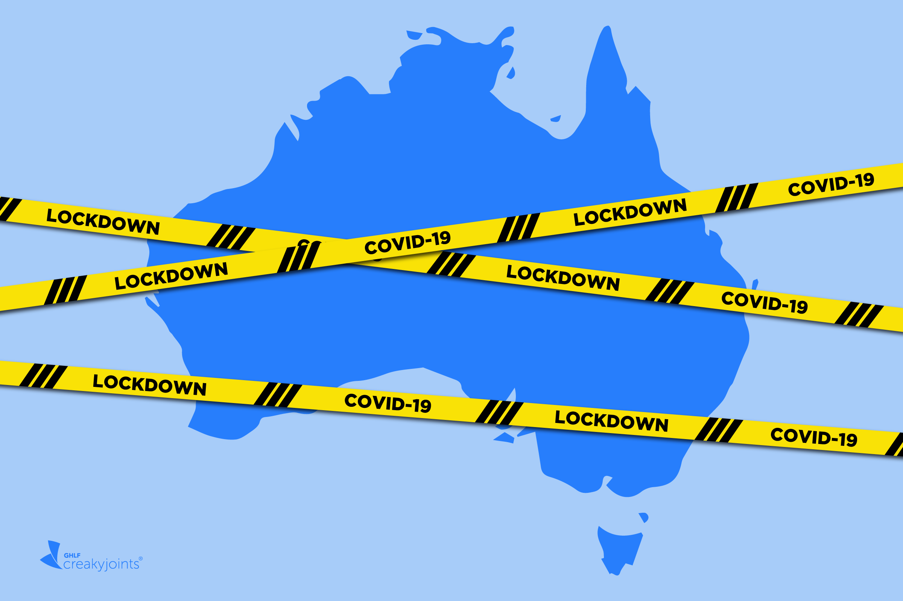
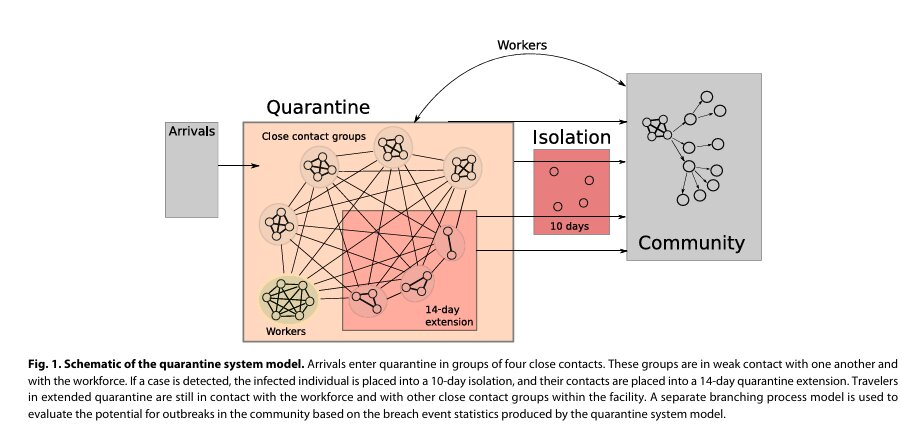
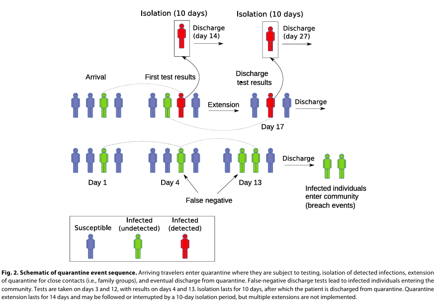

Wondering if it was just one thing that worked to curtail COVID-19? Well,
you might find this reading interesting! 

 {#fig-thumb}

## Understanding What Border Quarantine is all about

When today we speak of COVID 19, it becomes a significant divider between the world before and after it. Lives were disrupted, saddening news and the global movement came to a halt. Amdist this, researchers and medical professionals all over, were finding ways the spread could be best curtailed to protect the maximum. Border Quarantine, comes into the picture as one of the steps taken to safeguard millions acorss the world.

What exactly do we mean by border quarantine? It is a system designed to help prevent the spread of COVID-19 from infected travellers into countries. Moving forward, we explpore the study done, about the system, its effectiveness measured along with other methods of prevention like Vaccination, the models used, and what economic and social cost was borne in the process.

## The Challenge: To Keep The Borders Safe from stronger virus!

While the weak strains could have been handled easily through just quarantine, the emergence of Delta virus made the whole story of COVID 19 change. It brought a great need for researchers to change their vision about solving spread of the virus. 

Border quarantine helped countries such as Australia limit the spread of infections arriving from overseas. However, strict quarantine also came with costs. It disrupted travel and affected people, families and industries that relied on international movement.

The arrival of the Delta variant made the balance harder. Delta spread more easily than earlier versions of the virus, while vaccines were less effective at preventing infection and transmission than hoped. A system that worked under one set of conditions might not offer the same protection when the virus changed.

The study asked two connected questions:

*How does a more transmissible virus change the risk that an infection escapes quarantine?*
*If a breach happens, how much can vaccination across the wider community delay an outbreak?*

These questions matter because a quarantine breach does not automatically become a large outbreak. What happens next also depends on how easily the virus spreads and how much protection exists in the community.

### Guess What The Researchers found out! 

#### 1. A more transmissible virus puts more pressure on quarantine

The researchers built an individual-based computer model of a quarantine facility. It simulated travellers, workers, testing, isolation and situations in which an infected person could leave quarantine while still infectious. The simulated breach events were then used in a second model to explore the chance of community outbreaks.

In the study, a *quarantine breach* meant an infected traveller or worker exposed the wider community. The researchers compared different levels of vaccine effectiveness with different levels of viral transmissibility.

The @fig-original-quarantine-model from the paper shows how the researchers represented the quarantine facility and its links to the community. Arrivals were grouped into close contacts, workers could also be exposed, and detected infections were moved into isolation.

{#fig-original1 fig-cap="Original study, Figure 1: schematic of the quarantine system model. Reproduced from Zachreson et al. (2022). The diagram describes the model structure; it is not a record of one real quarantine facility." width="100%"}
Further the @fig-original1 explains quarantine was not modelled as a simple sealed box. People could have contact with others inside the facility, and an infected person could potentially reach the community.

The pattern was straightforward: as the virus became more transmissible, the risk linked to a breach increased. Higher vaccine effectiveness was needed to help keep that risk near the baseline level. In other words, a more infectious virus made the same quarantine arrangements harder to rely on.

{#fig-original-quarantine-sequence fig-cap="Original study, Figure 2: schematic of the quarantine event sequence. Reproduced from Zachreson et al. (2022). The sequence illustrates modelled processes and possible events, rather than a single observed case." width="100%"}

