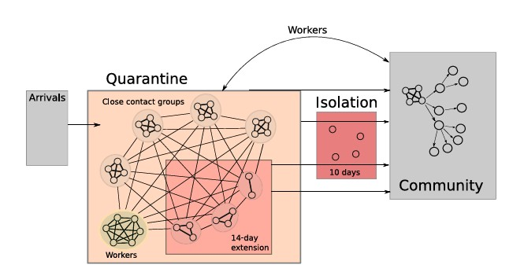
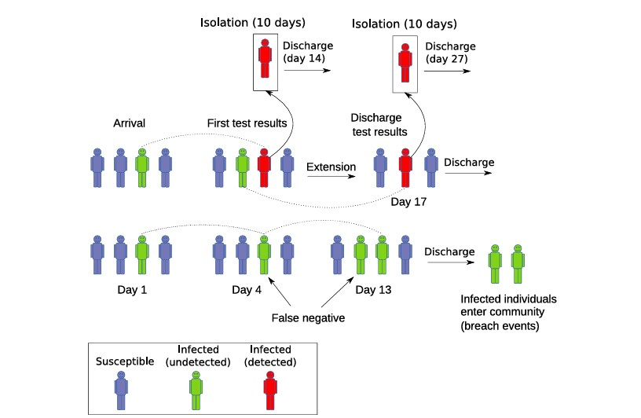
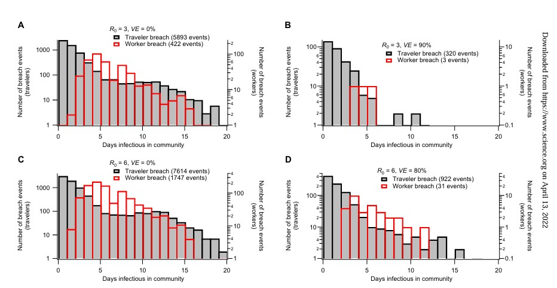

Wondering if it was just one thing that worked to curtail COVID-19? Well,
you might find this reading interesting! 

## Understanding What Border Quarantine is all about

When today we speak of COVID 19, it becomes a significant divider between the world before and after it. Lives were disrupted, saddening news and the global movement came to a halt. Amdist this, researchers and medical professionals all over, were finding ways the spread could be best curtailed to protect the maximum. Border Quarantine, comes into the picture as one of the steps taken to safeguard millions acorss the world.

What exactly do we mean by border quarantine? It is a system designed to help prevent the spread of COVID-19 from infected travellers into countries. Moving forward, we explpore the study done, about the system, its effectiveness measured along with other methods of prevention like Vaccination, the models used, and what economic and social cost was borne in the process.

## The Challenge: To Keep The Borders Safe from stronger virus!

While the weak strains could have been handled easily through just quarantine, the emergence of Delta virus made the whole story of COVID 19 change. It brought a great need for researchers to change their vision about solving spread of the virus. 

Border quarantine helped countries such as Australia limit the spread of infections arriving from overseas. However, strict quarantine also came with costs. It disrupted travel and affected people, families and industries that relied on international movement.

The arrival of the Delta variant made the balance harder. Delta spread more easily than earlier versions of the virus, while vaccines were less effective at preventing infection and transmission than hoped. A system that worked under one set of conditions might not offer the same protection when the virus changed.

The study asked two connected questions:

*How does a more transmissible virus change the risk that an infection escapes quarantine?*
*If a breach happens, how much can vaccination across the wider community delay an outbreak?*

These questions matter because a quarantine breach does not automatically become a large outbreak. What happens next also depends on how easily the virus spreads and how much protection exists in the community.

### Guess What The Researchers found out! 

#### 1. A more transmissible virus puts more pressure on quarantine

The researchers built an individual-based computer model of a quarantine facility. It simulated travellers, workers, testing, isolation and situations in which an infected person could leave quarantine while still infectious. The simulated breach events were then used in a second model to explore the chance of community outbreaks.

In the study, a *quarantine breach* meant an infected traveller or worker exposed the wider community. The researchers compared different levels of vaccine effectiveness with different levels of viral transmissibility.

{#fig-study1}

The @fig-study1 from the paper shows how the researchers represented the quarantine facility and its links to the community. Arrivals were grouped into close contacts, workers could also be exposed, and detected infections were moved into isolation.

Further the @fig-study1 explains quarantine was not modelled as a simple sealed box. People could have contact with others inside the facility, and an infected person could potentially reach the community.

The pattern was straightforward: as the virus became more transmissible, the risk linked to a breach increased. Higher vaccine effectiveness was needed to help keep that risk near the baseline level. In other words, a more infectious virus made the same quarantine arrangements harder to rely on.

{#fig-study2}

Testing, isolation and quarantine extensions were part of the model, but false-negative test results could still allow an infected person to be discharged and enter the community.This was seen by quarantine event sequence. @fig-study2 shows how testing and isolation reduced risk but did not remove it entirely. In the model, false-negative results and infections that were not detected could still lead to a breach.

#### 2. Vaccine effectiveness and vaccination coverage both matter

It is easy to treat vaccine effectiveness and vaccination coverage as if they mean the same thing. They do not.

- **Vaccine effectiveness** describes how well a vaccine works under the conditions being studied.
- **Vaccination coverage** describes the share of the community that has been vaccinated.

The researchers modelled several combinations of these factors. Their results suggested that, in the Delta-like scenarios they examined, vaccine effectiveness below about 60% did not greatly delay the point at which an outbreak became likely, even when coverage was high. At effectiveness levels of 80–90%, increasing coverage could produce a much larger delay.

The study defined an outbreak as at least five cases and measured the time until the model estimated a 50% probability of an outbreak. These are model outputs, not a promise that an outbreak will occur on a particular day.

The study also examined how long infected travellers or workers could remain infectious in the community after a breach. Breach event selected scenarios compares the modelled timing of breach events across scenarios with different transmissibility and vaccine-effectiveness assumptions 

{#fig-study}

@fig-study illustrates, the number and timing of breach events varied across the modelled scenarios. The figure supports the broader finding that the risk depends on several interacting factors, rather than on quarantine arrangements alone as mentioned in the [original research article](https://cwd.numbat.space/assignments/assignment-2-papers/Zachreson2021.pdf)

| Scenario explored in the study | What the model found | Implication |
|:--|:--|:--|
| Virus becomes more transmissible | More vaccine effectiveness was needed to maintain a similar level of quarantine protection. | A stronger-spreading virus puts more pressure on the same safeguards. |
| Vaccine effectiveness is below about 60% | Even high community coverage did not greatly delay the modelled outbreak threshold. | High coverage alone did not make a lower-effectiveness vaccine enough to delay outbreaks in these scenarios. |
| Vaccine effectiveness is around 80–90% | Greater community coverage could substantially increase the time until the modelled outbreak threshold was reached. | When the vaccine worked well in the model, vaccinating more people made a bigger difference. |
| Quarantine and community vaccination are combined | The study found that vaccination within quarantine needed to be paired with broader community vaccination to manage Delta-like risk. | Protection at the border cannot replace protection across the community. |

: Summary of the study's main modelled scenarios. {#tbl-vaccine-scenarios}

As @tbl-vaccine-scenarios summarises, the result was not simply “vaccinate more” or “make quarantine stricter”. The effects depended on how transmissible the virus was, how effective the vaccine was against transmission, and how much of the community was vaccinated.

### 3. What kind of evidence is this?

[Zachreson et al. (2022)](https://www.science.org/doi/10.1126/sciadv.abm3624), published in Science Advances, used two linked computer models to simulate quarantine breaches and estimate community outbreak risks. They also compared their findings with reported Australian quarantine-breach and outbreak data.

This approach allowed researchers to test different scenarios, but the results depend on model assumptions about vaccination, testing and virus transmission. Therefore, the findings show possible risks rather than exact predictions.

## Conclusion: No single lock can do the whole job

So, can vaccines keep a border safe? The study suggests that vaccination can help, but border quarantine cannot make up for low vaccination across the community when facing a highly transmissible virus such as Delta.

The strongest message is about layers of protection. Quarantine and infection-control measures can reduce the chance of an infection escaping. If a breach happens, high vaccine effectiveness combined with high community coverage can help delay an outbreak. The balance changes as the virus and vaccine performance change.

This is why the findings of the study matter. Public health decisions need to consider quarantine, infection control and community vaccination together. Their model does not predict every real-world outcome, but it shows why relying on one measure alone can leave gaps in protection.

